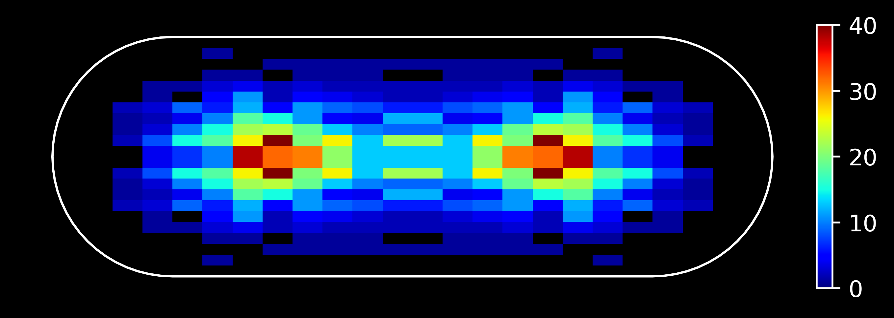
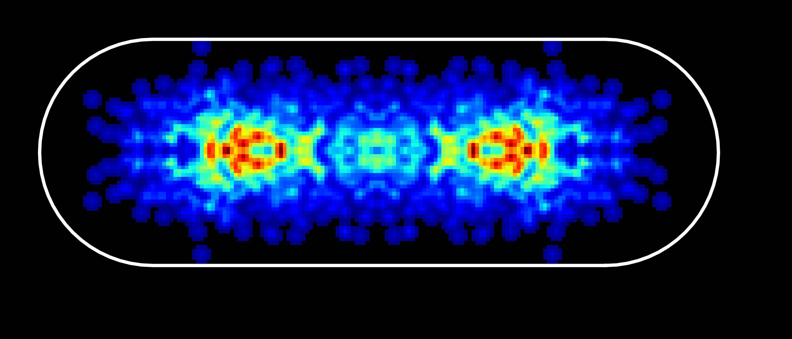

# napari-moltrack

[](https://github.com/piedrro/napari-moltrack/raw/main/LICENSE)
[](https://pypi.org/project/napari-moltrack)
[](https://python.org)
[](https://napari-hub.org/plugins/napari-moltrack)

A user-friendly SMLM analysis platfrom for napari, which includes single molecule localisation, tracking, and analysis features. 
Based on established python packages such as **MolCore**, **Picasso** and **Trackpy**.
This plugin was designed to detect/track single molecules inside cells, but can be used for any other SMLM/tracking application.

All functions are parallelised/GPU accelerated where possible to increase performance.
Multiple datasets can be loaded and processed in parallel.

Press **Ctrl+.** in the MolTrack window to cancel background processing.
Cancelled workers discard their results; controls become available when the
workers finish. Native calculations may need to finish their current step before
stopping. Escape retains its shape-editing behavior.

The processing backend uses MolCore for movie reading, localisation, tracking,
rendering, filtering, clustering, drift correction, photometry and trajectory
statistics. A persistent `ProjectSession` owns the MolCore Dataset; GUI tables,
images and layers are detached projections of its sources, localization IDs and
track memberships. GUI actions capture settings and process model snapshots;
validated results publish atomically on the GUI thread. Array-based entry points
in `moltrack.backend` remain available for scripts.
Picasso GPU fitting appears in the existing fitting selector when Picasso detects
a CUDA device; otherwise Picasso CPU fitting is available. The custom MolTrack
detector remains available through a MolCore backend extension.

Development uses Python 3.12, napari 0.9.2 and PyQt6 via QtPy. Segmentation uses
Cellpose 3 models (cyto3, cyto2, cyto and nuclei) or compatible custom weights.
Built-in segmentation weights download on first use.

Development is pinned to Cellpose 3.0.9 and MolCore Git revision
`1f6ea9a8b33796424566fd467567efdb00cac651` in `pyproject.toml` and `uv.lock`.
Both the default `.venv` and `.verify312` use Python 3.12.3 with this revision.
On Windows, run GUI tests with `QT_API=pyqt6`:

```powershell
$env:QT_API='pyqt6'
.verify312/Scripts/python.exe -m pytest tests src/moltrack/_tests -q --tb=short --disable-warnings
```

New projects use `.moltrack.h5`, a native MolCore HDF5 snapshot you can open
with `molcore.Dataset.open`. Segmentation masks, editable outlines and fitted
cells are stored as native records. A MolTrack group retains display settings,
project labels and legacy annotations. MolTrack can also open both historical
`.moltrack` formats. Saving replaces the destination after writing the complete
snapshot.

The image checkbox controls embedded pixels. Image-free projects retain geometry
and tables; pixel analysis requires an available source. Their zero-valued display
placeholder is labeled and is never used as scientific image data. Legacy projects
are converted into detached candidates before adoption. Already-corrected legacy
arrays establish a corrected baseline, so saved corrections are not applied twice.
When old files lack exact geometry or pixels, conversion records inferred geometry
and unresolved source provenance explicitly. Unknown historical registration is
not reconstructed from original file paths. Unsupported annotation objects fail
explicitly instead of being silently omitted.

Single molecule localisations can be filtered by their properties (e.g. photons, width, etc.) and can be rendered as a super resolution image.

Napari-moltrack is also compatible with **FRET** and **ALEX FRET** image data, can be used to calculate FRET efficiencies of single molecules/tracks.

Segmentations can be used to exclude regions from single molecule localisation and tracking.
Segmentations can be added automatically using Cellpose or can be added manually. Includes tools for editing/modifying segmentations at a sub-pixel resolution.

Compatible with both single and multi-channel .tif and .fits files.

napari-moltrack was written by Piers Turner, Kapanidis Group, University of Oxford.

https://www.physics.ox.ac.uk/research/group/gene-machines

----------------------------------

This [napari] plugin was generated with [Cookiecutter] using [@napari]'s [cookiecutter-napari-plugin] template.

<!--
Don't miss the full getting started guide to set up your new package:
https://github.com/napari/cookiecutter-napari-plugin#getting-started

and review the napari docs for plugin developers:
https://napari.org/stable/plugins/index.html
-->

## Installation

### Windows desktop installer

Windows desktop builds install MolTrack with its own Python runtime and open the
MolTrack interface directly from a Start menu shortcut. Build instructions and
release checks are in [Windows desktop distribution](docs/windows-installer.md).
The manually triggered **Windows installer** GitHub Actions workflow produces
`MolTrack-Setup-<version>-x64.exe` and verification artifacts.
The Windows installer uses CPU processing to keep downloads smaller. Python
installations from GitHub can still use CUDA-enabled dependencies for acceleration.

### Python package

You can install `napari-moltrack` via [pip]:

    pip install napari-moltrack

To update `napari-moltrack` to the latest version, use:

    pip install napari-moltrack --upgrade

To install latest development version :

    pip install git+https://github.com/piedrro/napari-moltrack.git


## BactFit

napari-moltrack integrates BactFit, a package for fitting the shape of rod shaped bacterial cells to an ideal cell model.
BactFit allows cell renders and heatmaps to be generated through the transformation of SMLM localisations to an ideal cell model.

### BactFit Heatmap



### BactFit Cell Render




## Contributing

Contributions are very welcome. Tests can be run with [tox], please ensure
the coverage at least stays the same before you submit a pull request.

## License

Distributed under the terms of the [BSD-3] license,
"napari-moltrack" is free and open source software

## Issues

If you encounter any problems, please [file an issue] along with a detailed description.

[napari]: https://github.com/napari/napari
[Cookiecutter]: https://github.com/audreyr/cookiecutter
[@napari]: https://github.com/napari
[MIT]: http://opensource.org/licenses/MIT
[BSD-3]: http://opensource.org/licenses/BSD-3-Clause
[GNU GPL v3.0]: http://www.gnu.org/licenses/gpl-3.0.txt
[GNU LGPL v3.0]: http://www.gnu.org/licenses/lgpl-3.0.txt
[Apache Software License 2.0]: http://www.apache.org/licenses/LICENSE-2.0
[Mozilla Public License 2.0]: https://www.mozilla.org/media/MPL/2.0/index.txt
[cookiecutter-napari-plugin]: https://github.com/napari/cookiecutter-napari-plugin

[file an issue]: https://github.com/piedrro/napari-moltrack/issues

[napari]: https://github.com/napari/napari
[tox]: https://tox.readthedocs.io/en/latest/
[pip]: https://pypi.org/project/pip/
[PyPI]: https://pypi.org/

## MolCore 0.2 integration

This checkout uses MolCore 0.2 at the revision recorded in `uv.lock`. Processing captures immutable snapshots, passes selections and an
execution context, then publishes results on the GUI thread. Project storage uses
MolCore format 7 only; older native MolCore files require explicit conversion
with the previous release. Keep originals before upgrading. Legacy MolTrack
project import remains available.
